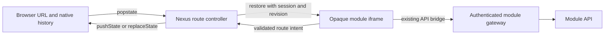

# Nexus navigation and history proposal

The local Nexus + Mnemosyne pilot is now implemented following user approval.
Use [the current integration contract](../../navigation-history.md) for activation,
SDK adoption and wire/lifecycle behavior. See [PILOT.md](PILOT.md) for changed
files, recorded real-app results and rollout limits. The design investigation below is
retained as the original architecture record; its no-runtime-change statements
describe the initial documentation/prototype stage.

Original investigation status: **design/prototype; superseded by a default-off
local implementation, not approved for production rollout**. Investigated
2026-11-05 against Nexus HEAD `b421f73b47797618a26aa0ab5ee4eb2d1e50e507`
and the current working trees. Those trees contain existing uncommitted changes;
this proposal does not alter them. No production module, host router, manifest,
gateway, authentication flow or deployment is changed by these files.

## Existing architecture and evidence

Paths below are relative to `G:/AureateEmpyrean`.

| Layer | Observed implementation | Consequence |
| --- | --- | --- |
| Shell URL | `empyrean-nexus/frontend/router.js:1-33`: `/app/overview`, `/app/modules`, utilities, `/app/modules/<id>?path=<path>`. `path` defaults to `/` and accepts only `/[A-Za-z0-9/_-]*`, excluding `//`. | Keep these URLs valid. `path` is an HTTP bootstrap path, not arbitrary serialized state. |
| Host history | `createRouter`: `navigate` pushes only changed pathname + query, then calls its callback; `popstate` rereads the URL. Hash is ignored. | Shell navigation works; there is no protocol for internal module state. Mouse Back/Forward should use this same browser traversal path. |
| Host rendering | `frontend/app.js:176`, `:458`, `:876`: every module render writes iframe HTML using `/modules/<id><modulePath>`. | Routing a same-module change through the current callback recreates the iframe and loses local state. Refresh rendering must also preserve a mounted participating frame. |
| Isolation | Application iframe uses `sandbox="allow-scripts allow-downloads"`; non-application iframe only `allow-scripts`. Neither grants same-origin or top-navigation. | Parent cannot inspect the child DOM or state. Do not add same-origin or top-navigation to implement history. |
| Bridge | `frontend/app.js:1094`: only current `#module-application.contentWindow`, enabled `ui.application`, `empyrean-v1` and bounded request ID accepted. `context`, `request`, `navigate`, `external`. | Existing `navigate` only switches module ID / `nexus`; it drops internal route information. Successful switching currently sends no reply. Preserve old behavior. |
| Proxy/auth | `backend/nexus/app.py:711`: `/modules/{module_id}/{path:path}` requires owner; disabled modules fail; empty path selects manifest `routes.ui`; validates paths; forwards query; injects gateway key upstream; strips cookies/auth/redirects/CSP on response. CSP is opaque sandbox, no network/forms. `/app/*` serves the shell. | Navigation is never an authorization grant or an API request. Keep the gateway and CSRF checks intact. |
| Resource links | `backend/nexus/references.py:80,353`: resolver `open_path` is a bounded simple path, returned with `/app/modules/<id>`. | Resource identity remains independent of URLs. Existing resolver paths and links must continue to work. |

Module survey (read-only):

| Module | Current navigation | Migration pressure |
| --- | --- | --- |
| Lyra | `frontend/app.js:118,252`: route object + private history stack; `back()` pops it. Direct state assignments also follow adding a title. | Replace private stack in hosted mode; route schemas for library, title and provider preview; cover assignments as well as `navigate()`. |
| Chronos | `frontend/app.js:254,1318`: `view`, `cursor`; `go()` and `step()` mutate these and load occurrences. | Serialize view/date and intentionally linkable filters; keyboard and mini-calendar actions must use the adapter too. |
| Mnemosyne | `frontend/app.js:1216`: `go()` flushes edits before mutation; startup around `:4575` parses `/w/<workspace>/r/<resource>`. Search also mutates view directly. | Preserve workspace/resource paths and autosave/flush semantics; protect drafts before restoration and invalidate async rendering. |
| Meridian | `frontend/app.js:478,490,3723`: `go()` checks dirty panels; `routeFromLocation()` parses people/org/group URLs once. | Retain those legacy deep links; include selected profile tab when linkable; save graph/timeline ephemeral state separately. |
| Zeus | `frontend/app.js:352`: `go(view, params)` changes memory; existing API bridge. | Define views and stable task/conversation IDs, exclude chat content and approval material from URLs. |
| Argus / Janus | No matching Nexus navigation bridge found in the surveyed JS/TS/HTML/Python. Janus includes a separate vault/PWA UI and worker messages. | Do not infer Nexus integration from generic `postMessage`; leave untouched until an application adapter is identified. |

The five application backends above have catch-all HTML shell routes. That does
not mean their frontend restores every URL: Lyra/Chronos/Zeus mostly start from
memory defaults, while Meridian and Mnemosyne parse specific legacy paths.

## Proposed contract



### One history writer and two distinct paths

Nexus is the only hosted history writer. A module supplies a **route reference**:
a module-local absolute path with optional query and fragment. Nexus treats it as
data and never fetches it, concatenates it into the gateway URL, or interprets its
domain schema. Each module owns parse/serialize/normalize and unknown-route UI.

Canonical envelope:

```
/app/modules/meridian?path=%2Fpeople%2F<uuid>&nav=1&route=%2Fpeople%2F<uuid>%3Ftab%3Dnotes%23recent
```

* The original module URL and optional `path` remain intact. No path aliases,
  redirects, new proxy routes or migration of stored resource identities.
* `nav=1&route=...` is additive. Use `URLSearchParams` exactly once for outer
  encoding/decoding; route queries/fragments stay inside `route`. Do not use the
  outer fragment as a second route store.
* No `nav`: legacy mode. Bootstrap iframe using the original `path`; after a new
  module handshakes it can publish a normalized route using **replace**, never
  push. Legacy `path` can be mapped to an initial route by that module.
* `nav=1` requires exactly one nonempty `route`; reject duplicate reserved fields,
  unsupported versions and malformed routes with a shell link-error UI. Do not
  silently open a different resource. Unknown unrelated shell query fields survive
  internal updates. Legacy duplicate `path` keeps today's first-value semantics
  when there is no new envelope; new envelopes reject duplicates.
* Keep the existing `path` validation for bootstrap. Route references are <= 2048
  UTF-8 bytes, use one leading slash, no scheme/authority, backslash, control or
  whitespace, malformed `%` escapes, dot segments or encoded separators in the
  pathname. Query/fragment may contain percent-encoded Unicode and punctuation.
  Module codecs restrict keys, types and resource IDs, and use stable ordering.
  Never double-decode. URLs contain IDs/view choices, never drafts, tokens,
  credentials, personal text or request bodies. Sharing still requires login and
  resource permission; browser history persists URL data.

Old Nexus ignores the extra fields and loads the preserved bootstrap `path`.
Consequently a new route's internal state can degrade to the legacy view after
host rollback; it cannot be restored exactly by an unmodified old host/module.
This is a compatibility limit, not a reason to rewrite old links. New links should
carry a useful existing bootstrap path when one is available. Legacy modules
continue working with their existing navigation; arbitrary private memory state
cannot be deep-linked without a module adapter.

### Opt-in message extension

Add `navigation: {versions:[1]}` to the existing `context` result. No new manifest
privilege is needed: this is bounded navigation data within `ui.application`.
Do not require legacy modules to send new messages. A new module uses a separate
channel `empyrean-navigation-v1` only when the host advertises it. Old hosts return
no advertisement; the shared adapter uses legacy memory navigation without
waiting for unsupported requests. Embedded standalone preview remains supported;
a real standalone deployment may opt into its own history driver, never both.

All messages are plain bounded objects. Fields below are required unless stated.
The host binds module identity to the active iframe, never to a claimed module ID.

| Direction / type | Fields | Meaning |
| --- | --- | --- |
| child `hello` | `document` random ID, `version:1` | Sent after adapter listener installed. The host creates a random frame-session ID and responds with authoritative state. Retry the same hello if needed; same document gets same session. |
| host `restore` | `document`, `session`, monotonic `revision`, `route`, `cause` | Initial / traversal / commit / resync. Child accepts only parent, matching document/session, increasing revision (duplicates acknowledged). Validate, resolve and render without emitting a navigation intent. |
| child `commit` | `session`, `baseRevision`, `route`, `mode:'push'|'replace'` | Intent after local save/guard, before changing committed view. Validate active frame, enabled capability, current session/revision, size and route. Duplicate URL is a no-op; send restore as acknowledgment. |
| child `applied` | `session`, `revision`, `status:'ok'|'not-found'|'error'` | Confirms rendering. Host exposes restoration error/retry if unresolved, does not erase target URL or push a fallback. No resource contents in status. |
| host `reject` | `session`, `revision`, bounded `code` | Invalid route, stale revision, inactive module, rate limit. Resync with current restore for stale intent; never apply it later. |

Source checks: host requires `event.source === mountedFrame.contentWindow` and
the bound enabled application. `event.origin === 'null'` alone authenticates
nothing. Child requires `event.source === parent` and the known Nexus origin
when available. Parent replies to an opaque child with `'*'` only because no
concrete target origin exists; route/status only, never auth data. New handshake
per frame document; reset on load, logout, disable or unmount. Fresh element for
cross-module mounts prevents old WindowProxy messages from reaching a new module.
Session/revision are freshness markers, not authentication credentials. Ignore
foreign/obsolete messages. Bound size, retry count and per-frame intent frequency.

### History and rendering rules

1. On deep link / reload, authenticate normally while leaving the URL in place.
   After authentication and module metadata load, validate envelope and enabled
   module, load only the preserved bootstrap HTTP path, then handshake and restore
   route. Do not flash/replace it with the module default. No URL return-to
   parameter may redirect outside Nexus. Missing/disabled modules keep the target
   URL and show existing host status UI; enable retries that target.
2. Clicks, opening resources, tab changes that represent distinct views: push once
   after the module's save/guard succeeds. Canonicalization, initial legacy-route
   adoption, filter typing/debounced changes: replace. A module defines these
   choices consistently. Keystrokes, polling, data mutations and hover never push.
3. Commit processing synchronously validates base revision, writes the top URL,
   increments revision, then sends restore/ack. The child renders committed state
   only from restore. Serialize intents; coalesce pending replaces; never retry a
   stale intent against a newer traversal. If History API fails, reject before
   updating protocol state. Preserve other `history.state` keys; namespaced state
   is optional metadata, and URL is sufficient after reload/bookmark.
4. `popstate` reads the target URL, invalidates pending renders/intents and
   increments the host revision. Same module: retain the iframe, send restore;
   different module or legacy bootstrap path: teardown and mount the right frame.
   Applying restore never calls `pushState` or echoes commit. Cancel old loads and
   guard every async DOM write against revision; late API responses cannot paint
   the previous resource over the current one. BFCache `pageshow.persisted`
   rechecks session/module state and resyncs without adding history.
5. A module switch remains one top-level entry. Do not assign `src` repeatedly to
   a retained iframe. Use a fresh iframe per module/document and verify its initial
   load does not create an extra traversal step. Participating modules do not use
   child History API, `location`, hash links or internal document navigations:
   child navigations contribute to tab history too. Generic legacy document
   navigation remains legacy behavior, not silently intercepted.
6. Browser buttons, keyboard and mouse navigation buttons all traverse native
   history. Do not intercept `auxclick`, mouse buttons 3/4, or globally catch
   Alt+Left/Right. An in-app Back affordance may delegate to host traversal only
   when host knows the preceding entry belongs to its tracked chain; otherwise
   navigate to a deterministic module parent. Do not blindly leave the app.

Dirty data: a browser `popstate` cannot simply be canceled. Before migrating
Mnemosyne/Meridian, implement safe draft retention + revision-aware asynchronous
flush. If saving fails during traversal, keep a recoverable editor/draft overlay
while the route shell reflects the target and offers retry/recovery. Never discard
edits or automatically `history.go(1)` (which loops/races and breaks Forward).
Cross-module unmount needs draft persistence before teardown. `beforeunload` may
provide a last-resort full-document warning, not the SPA navigation solution.
This draft policy is a production migration gate, not implemented by the prototype.

## Migration and acceptance gates

1. Review this contract and run isolated proof below. Freeze URL vectors and
   message schemas with test fixtures. No production migration at this stage.
2. Implement a shared dependency-free host controller + child adapter and contract
   tests in Nexus. Bundle child adapter inline using each module's existing build
   (gateway CSP forbids external scripts/network). No wildcard API access, manifest
   capability expansion, gateway path relaxation or auth changes.
3. Integrate host behind a default-off local feature flag. Preserve current router
   for nonparticipants; add incremental same-module reconciliation and lifecycle
   cancellation. Confirm refresh/poll does not remount participating frames.
   Verify old/new host x old/new module combinations, including host rollback with
   a new bookmark. Existing bridge `request`, `external`, `navigate` unchanged.
4. Pilot a fixture module, then one read-only view in a locally run application.
   Add module-owned route codecs first; retain legacy path parsing. Audit direct
   assignments, switchers, keyboard shortcuts, reference-open links and in-app
   Back. Do not replace all modules' routing with a generic domain router.
5. Suggested module order: Chronos view/date, Lyra library/title, Meridian profile,
   Mnemosyne workspace/resource, Zeus views. Meridian/Mnemosyne require tested
   draft recovery first. Resolve exact per-module route maps in their own design
   reviews; example routes here are proposals, not assertions of current APIs.
6. Before enabling in production: repeat with actual authenticated local Nexus,
   gateway CSP, old module images, restarted containers and representative data;
   Chromium + Firefox + supported WebKit; real keyboard, browser and mouse buttons;
   bookmark/copy/reload/new tab; cross-module Back/Forward; rapid traversals during
   slow API loads; missing/deleted/forbidden resources; disabled/uninstalled modules;
   expired session/login/logout; BFCache; dirty editor/save failure; forwarded query
   escaping; forged sibling/retired-frame messages; malformed/oversized routes;
   one entry per action and no iframe history traps. Record visible view + URL,
   not just history length. Roll back by disabling host feature and retaining
   bootstrap URLs; downgrade modules independently through capability detection.

## Local proof and limits

`protocol.mjs`, `server.mjs`, `browser-proof.py` and `protocol.test.mjs` are isolated
fixtures, not loaded by the application. See `VALIDATION.md` for commands/results.
They exercise URL preservation, route validation, active-source/session/revision
checks, and real browser traversal with opaque iframe CSP. Fixture hello assumes
feature discovery already succeeded. It intentionally does not implement real
authentication, draft recovery, resource APIs, rate limiting, applied timeouts or
production rendering. Passing it validates the core mechanism only, not approval
to migrate production modules.

Platform references checked 2026-11-05:

* [WHATWG navigation](https://html.spec.whatwg.org/dev/browsing-the-web.html):
  child navigations participate in the tab's history. This is why parent-only
  writes and real iframe traversal tests are necessary.
* [WHATWG messaging](https://html.spec.whatwg.org/dev/web-messaging.html): validate
  message source/data and limit processing of untrusted messages.
* [Chrome origin guidance](https://developer.chrome.com/docs/modern-web-guidance/guides/security/validate-origins):
  opaque sandbox frames require source checks; comparing `null` origins is unsafe.
